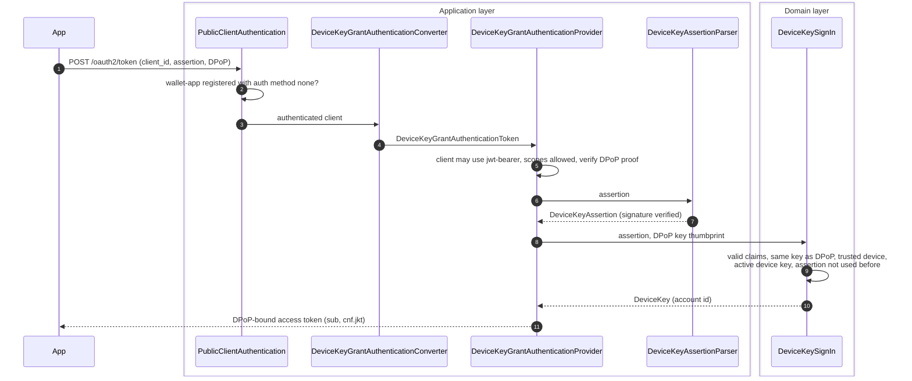

<!--
SPDX-FileCopyrightText: 2026 Digg - Agency for Digital Government

SPDX-License-Identifier: CC0-1.0
-->

# Wallet Authorization Server

[](https://github.com/diggsweden/wallet-authorization-server/tags)
[](https://api.reuse.software/info/github.com/diggsweden/wallet-authorization-server)
[](https://scorecard.dev/viewer/?uri=github.com/diggsweden/wallet-authorization-server)


**Description**: Authorization server for the European Digital Identity Wallet ecosystem.
It authenticates wallet devices and issues access tokens, in the OAuth 2.0 role of
authorization server.

## Table of Contents

- [Installation and Requirements](#installation-and-requirements)
- [Quick start instructions](#quick-start-instructions)
- [Usage](#usage)
- [Device key sign-in](#device-key-sign-in)
- [Support](#support)
- [Contributing](#contributing)
- [License](#license)
- [Maintainers](#maintainers)

## Installation and Requirements

- Java 25

## Quick start instructions

```shell
./mvnw spring-boot:run
```

The server starts on port 9000. Without `SIGNING_KEY` (an EC P-256 private JWK) it generates
an ephemeral signing key.

## Usage

The app signs in with its **device key**, a sign-in method of the account. The app gets a
short-lived access token with scope `wallet`, bound to the device key with DPoP. The server does
not know about wallets: services that need one find it in wallet-account by `sub` and `cnf.jkt`.

The app sends a [jwt-bearer](https://www.rfc-editor.org/rfc/rfc7523) token request:

```http
POST /oauth2/token
Content-Type: application/x-www-form-urlencoded
DPoP: <DPoP proof signed with the device key>

grant_type=urn:ietf:params:oauth:grant-type:jwt-bearer
&client_id=wallet-app
&assertion=<ES256 JWT signed with the device key>
```

The assertion has the device public key in its `jwk` header and the claims `iss` (client id),
`aud` (issuer), `iat`, `exp` (at most 5 minutes later) and `jti`. The DPoP proof must use the
same key. The access token is an ES256 JWT with:

- `sub`: the account id
- `cnf.jkt`: the device key thumbprint

The DPoP proof is accepted if its `iat` is within 30 seconds of the server clock, and its `jti`
has not been used before. The proof's freshness relies on the app's clock. A server-provided
`DPoP-Nonce` ([RFC 9449, section 8](https://www.rfc-editor.org/rfc/rfc9449#section-8)) would add
protection against proofs created ahead of time, but is not supported yet.

An unknown or suspended device key gets `invalid_grant`. Device keys are kept in memory; there is
no registration yet.

Other endpoints:

- `GET /.well-known/oauth-authorization-server` - metadata
- `GET /oauth2/jwks` - public signing keys

## Device key sign-in

A token request passes Spring Authorization Server's two steps: client authentication, then the
grant. The application layer turns HTTP and JOSE input into checked types; the sign-in rules are in
the domain layer.



- A failed client check gives `invalid_client`, a rejected sign-in `invalid_grant`.
- Issued tokens are not stored: there is no refresh, introspection or revocation, and resource
  servers verify tokens against the JWKS.
- The domain reaches device keys, attestation and replay protection through the interfaces
  `DeviceKeyCredentials`, `AttestationVerifier` and `ReplayCache`. Their implementations in
  `infrastructure` are interim: in memory, and attestation is not verified yet.

## Support

If you have questions, concerns, bug reports, etc, please file an issue in this repository's Issue Tracker.

## Contributing

See [CONTRIBUTING](CONTRIBUTING.md).

---

## License

This project is licensed under the European Union Public Licence v. 1.2 (EUPL-1.2) - see the [LICENSE](LICENSE) file for details.

The [CODE_OF_CONDUCT](CODE_OF_CONDUCT.md) is from the [Contributor Covenant](https://www.contributor-covenant.org/) and licensed under CC-BY-4.0.

---

## Maintainers

See [CODEOWNERS](CODEOWNERS).
